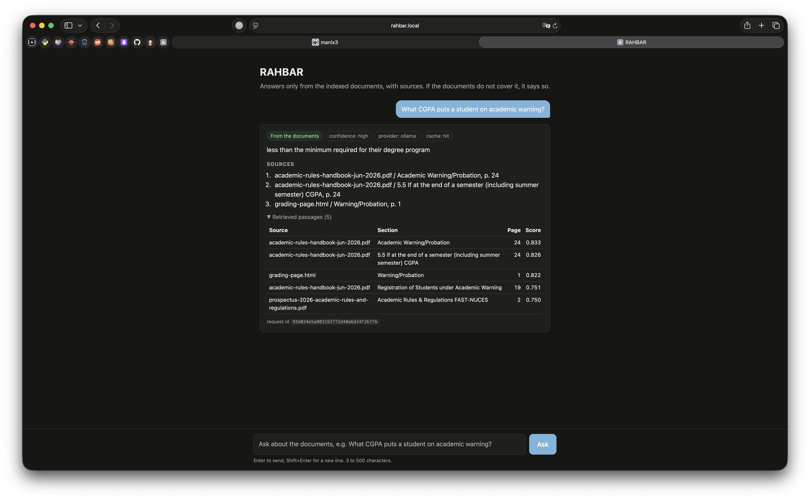
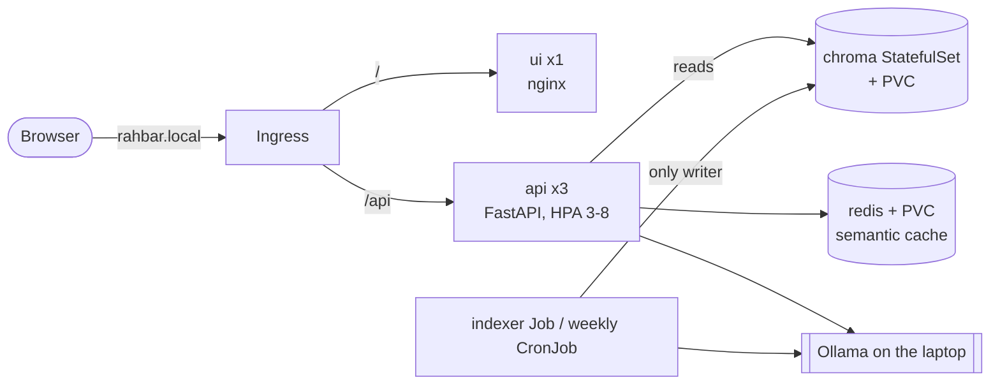

# RAHBAR: grounded answers about FAST-NUCES rules, on Kubernetes

[](https://github.com/EimanW/rahbar/actions/workflows/ci.yml)
[](https://github.com/EimanW/rahbar/actions/workflows/cd.yml)
<!-- replace EimanW/rahbar with the GitHub path once the repository exists -->

A student wants to know whether they can register for a course after failing its prerequisite.
The answer is in a clause of a university PDF, next to an older edition of the same rules that
is still on the website, and a general-purpose chatbot will answer confidently from some other
university's rules. **RAHBAR** answers only from the FAST-NUCES documents it has indexed, cites
the clause it used, prefers the current edition over a superseded one, and says "the documents
do not cover this" instead of inventing an answer. It runs as a set of Kubernetes objects:
a reader api that scales horizontally, a vector store with its own volume, a cache, and an
indexer Job that re-indexes without a redeploy.

CS4032 Software Construction & Development, Assignment 02. Course work by Eiman Wasim and
Umm-e-Sulaim.


<!-- TODO(team): save a screenshot of the chat UI answering with a citation at that path -->

## Architecture



One writer (the indexer Job), one reader (the api), one shared pin (`EMBED_MODEL` in one
ConfigMap). Full object list and the security closures: [docs/ARCHITECTURE.md](docs/ARCHITECTURE.md).

**Query path, every question:** validate (3 to 500 chars) → semantic cache (skipped for
follow-ups) → embed with the pinned model → top-k from Chroma with superseded editions filtered
out → relevance floor (abstain without calling the model) → numbered, delimited evidence →
schema-constrained generation at low temperature → validate, retry once, safe fallback → drop
any citation that was not retrieved → cache only if safe → one JSON log line.

## From a clean clone to an answered question (macOS / Linux)

Prerequisites: Docker Desktop (or Docker Engine), `minikube`, `kubectl`, Python 3.12, `make`,
and [Ollama](https://ollama.com). On Windows use WSL 2.

```bash
# 0. tools for tests and lint (optional for the demo)
make install && make test

# 1. cluster: Calico, so NetworkPolicy is enforced, plus metrics-server and ingress
make cluster
#    = minikube start --driver=docker --cni=calico --memory=6144 --cpus=4
#      minikube addons enable metrics-server && minikube addons enable ingress

# 2. Ollama on the laptop, listening on all interfaces so the cluster can reach it
OLLAMA_HOST=0.0.0.0 ollama serve &          # leave it running
ollama pull llama3.2:3b && ollama pull nomic-embed-text

# 3. corpus: download the public documents listed in corpus/sources.yaml
make fetch                                  # -> corpus/raw/ (gitignored) + corpus/MANIFEST.md
python corpus/fetch.py --verify             # same bytes as the committed manifest?

# 4. images: build all three and load them into minikube (the indexer image carries corpus/raw)
make images

# 5. apply, in this order
kubectl apply -k k8s/overlays/dev           # Namespace, ServiceAccounts, ConfigMap, NetworkPolicies,
                                            # chroma, redis, api, ui, HPA, Ingress, indexer Job, CronJob
make secret                                 # only for LLM_PROVIDER=hosted: export LLM_API_KEY=... first

# 6. the indexer Job runs once by itself (it waits for Chroma first); watch it finish
kubectl -n rahbar get jobs -w
kubectl -n rahbar logs job/indexer | grep -E "extracted|chunking summary|finished"

# 7. the api becomes READY only once the index exists and matches EMBED_MODEL
kubectl -n rahbar rollout status deployment/api
kubectl -n rahbar get pods

# 8. ask through the Ingress
make ask Q="What CGPA do I need to avoid an academic warning?"
```

`kubectl apply -k` sends the objects in dependency order (namespace first, then config, then
workloads). If you apply the files by hand instead, use: `namespace.yaml`, `serviceaccounts.yaml`,
`configmap.yaml`, `networkpolicy.yaml`, `chroma-statefulset.yaml`, `redis.yaml`, `api.yaml`,
`ui.yaml`, `hpa.yaml`, `ingress.yaml`, `indexer-job.yaml`, `reindex-cronjob.yaml`, all with
`-n rahbar`.

**macOS with the docker driver:** the minikube IP is not reachable from the Mac. Run
`minikube tunnel` in another terminal, then `make ask INGRESS_IP=127.0.0.1 Q="..."`. For the
browser, add `127.0.0.1 rahbar.local` to `/etc/hosts` and open <http://rahbar.local>.

**Re-index without a redeploy** (new documents, or a changed chunk size in the ConfigMap):
```bash
make index        # kubectl create job --from=cronjob/reindex reindex-<time> -n rahbar
```
The api keeps serving the old index until the new one is complete, then switches (ADR 0001),
and its cache starts a fresh namespace for the new index (ADR 0003).

## API

| Method | Path | Purpose |
| --- | --- | --- |
| POST | `/api/ask` | `{"question": "..."}` (3 to 500 chars) → answer, citations, `answered_from_context`, confidence, retrieved passages with scores, `cached`. 422 on a bad question, 503 when the index is unusable |
| GET | `/healthz` | Liveness: the process is alive. Touches no dependency |
| GET | `/readyz` | Readiness: 200 only if Chroma is reachable, the collection is non-empty, its embedding model matches `EMBED_MODEL`, and Redis answers; otherwise 503 naming what failed |
| GET | `/metrics` | Prometheus: requests and latency, retrieval and generation latency, cache hits/misses, abstentions, fallbacks, retries, removed citations, tokens in/out |

Every response carries `X-Request-ID` (taken from the request header or generated), and every
log line for that request carries the same id.

## Configuration
All settings come from `k8s/base/configmap.yaml` (one ConfigMap for api and indexer) and the
Secret `rahbar-secret`. The important ones: `EMBED_MODEL` (the pin), `TOP_K`, `RELEVANCE_FLOOR`,
`CACHE_THRESHOLD`, `TEMPERATURE` (0.2, justified in the file), `CHUNK_SIZE`/`CHUNK_OVERLAP`,
`LLM_PROVIDER` (`ollama-host` default, `ollama-incluster`, `hosted`, `stub`). Change one, then
`kubectl rollout restart deployment/api` (or `make index` for chunking). Embeddings go through
the same laptop Ollama as generation in `ollama-host` mode.

## Corpus
Public FAST-NUCES documents, never committed. `corpus/sources.yaml` lists them,
`corpus/fetch.py` downloads them politely, and `corpus/MANIFEST.md` records each URL and SHA-256.
How the corpus meets the seven required properties: [docs/CORPUS.md](docs/CORPUS.md).
Hostel rules are left out on purpose, so RAHBAR must decline those questions.

## Evaluation and the CI gate
```bash
make eval                                   # eval/golden.yaml (18 questions) through the Ingress
python eval/run_eval.py --api http://$(minikube ip) --host rahbar.local --update-baseline
```
CI fails when recall@5 drops more than 5 points below `eval/baseline.json`, when any
must-abstain question is answered, when citation validity falls below 95%, or when any citation
names a superseded document the question did not ask for. The e2e-eval CI job runs the whole
stack in kind on the fixture corpus (`eval/fixtures`, stub LLM, a deterministic CI embedder).
Method and numbers: [docs/PIPELINE.md](docs/PIPELINE.md); broken stages:
[docs/FAILURE-ANALYSIS.md](docs/FAILURE-ANALYSIS.md).

## CI/CD
- `ci.yml` (pull request to `main`, push to `dev`): lint (ruff, mypy) → test (pytest, coverage
  ≥ 60%, stub provider) → manifests (`kustomize build | kubeconform -strict`) → build (no push)
  → Trivy scan (HIGH/CRITICAL with a fix) and e2e-eval (kind cluster, indexer Job, rollout, gate).
- `cd.yml` (push to `main`): test → build-push to Docker Hub tagged `${{ github.sha }}` →
  deploy to an ephemeral kind cluster, `kubectl rollout status`, smoke test through the Ingress.
  Never `:latest`.
- Branches: `dev` for work, `main` protected (PR required, CI must pass, one approval).
- Secrets in GitHub: `DOCKERHUB_USERNAME`, `DOCKERHUB_TOKEN` (an access token, not the password).

## Troubleshooting
| Symptom | Usual cause | Fix |
| --- | --- | --- |
| `ImagePullBackOff` on `rahbar-*:dev` | minikube cannot see your Docker images | `make images` (it runs `minikube image load`) |
| Every service name stops resolving | default-deny egress blocks DNS | the `allow-dns-egress` policy must be applied |
| api `Running` but `0/1 READY` | empty collection, Redis down, or the embedding pin | `curl` `/readyz` via `kubectl -n rahbar port-forward svc/api 8000` and read `failed` |
| api cannot reach Ollama | Ollama on 127.0.0.1 only | `OLLAMA_HOST=0.0.0.0 ollama serve` |
| indexer `OOMKilled`, exit 137 | embedding a long PDF | raise the Job memory limit, guided by `kubectl top pods` |
| HPA shows `<unknown>/70%` | no metrics-server, or no `requests.cpu` | `minikube addons enable metrics-server`, wait a minute |
| ui can still reach chroma | cluster started without Calico | `minikube delete && make cluster` |
| chroma or redis `CrashLoopBackOff` with a permission error | the image wants to write outside its volume | `kubectl logs`; relax `readOnlyRootFilesystem` for that container only and note it in ARCHITECTURE.md |

Diagnose in this order: `kubectl get pods` → `kubectl describe pod` (Events at the bottom) →
`kubectl logs` (`--previous` for a crashed container).

## Repository map
`api/` the reader service · `indexer/` the Job's image, the only writer · `ui/` chat page on
nginx · `corpus/` sources, fetch script, manifest · `eval/` golden set, runner, baselines,
fixtures · `k8s/` base + overlays `dev`, `prod`, `ci` · `docs/` corpus, pipeline, failure
analysis, engineering notes, ADRs, evidence · `scripts/` submission checker, chunking sweep ·
`.github/workflows/` ci and cd.

## AI usage
Disclosed in [docs/AI-USAGE.md](docs/AI-USAGE.md).
