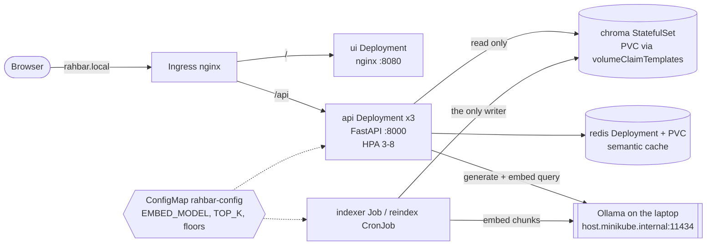

# Architecture

Everything runs in the `rahbar` namespace. All five Services are ClusterIP (`api`, `ui`,
`chroma`, `chroma-headless`, `redis`); only the Ingress is reachable from outside.

| Object | File | Why this kind |
| --- | --- | --- |
| Namespace `rahbar` | `k8s/base/namespace.yaml` | never `default` |
| Deployment `api` (3) + Service + HPA | `api.yaml`, `hpa.yaml` | stateless reader; probes, requests/limits, `maxSurge: 1`, `maxUnavailable: 0`, preStop sleep |
| Deployment `ui` + Service | `ui.yaml` | static files, nginx as uid 101, read-only root FS |
| StatefulSet `chroma` + 2 Services | `chroma-statefulset.yaml` | see below |
| Deployment `redis` + PVC + Service | `redis.yaml` | the cache; `Recreate` because the volume is ReadWriteOnce |
| Job `indexer`, CronJob `reindex` | `indexer-job.yaml`, `reindex-cronjob.yaml` | ADR 0001 |
| ConfigMap, Secret (placeholder only) | `configmap.yaml`, `secret.placeholder.yaml` | one source for the pin; the real Secret comes from `make secret` |
| NetworkPolicies | `networkpolicy.yaml` | deny by default, then the arrows above and DNS |
| ServiceAccounts (5) | `serviceaccounts.yaml` | one per workload, no token mounted, no Role: nothing calls the API server |

## Why Chroma is a StatefulSet, not a Deployment
1. **Storage that belongs to the pod.** `volumeClaimTemplates` gives `chroma-0` its own PVC
   (`data-chroma-0`) that is reattached to the same pod after a restart or reschedule. A
   Deployment shares one PVC between its replicas or none; a new Deployment pod could even start
   on another node before the old one releases a ReadWriteOnce volume.
2. **Stable identity.** The pod is always `chroma-0`, reachable as
   `chroma-0.chroma-headless.rahbar.svc` through the governing headless Service. A Deployment
   pod gets a random name on every restart.
3. **Ordered, one-at-a-time lifecycle.** A StatefulSet stops the old pod before starting its
   replacement, so two Chroma processes never open the same files. A Deployment's rolling
   update would run old and new together on one volume.
4. **One replica on purpose.** Chroma's single-node server has no replication protocol, so a
   second replica would be a second, divergent index, not high availability. Durability comes
   from the PVC and from the fact that the index can be rebuilt from the corpus by the Job.

## Security in one table (section 4.7)
| Hole | Closure here |
| --- | --- |
| Secrets in Git | `*-secret.yaml` gitignored; only `secret.placeholder.yaml` (REPLACE_ME, not in kustomization) is committed; README shows `make secret` |
| Everything is admin | one ServiceAccount per workload, `automountServiceAccountToken: false` on all pods |
| Containers as root | `runAsNonRoot: true`, numeric `runAsUser`, `readOnlyRootFilesystem: true`, `capabilities.drop: [ALL]`, `allowPrivilegeEscalation: false`, seccomp RuntimeDefault, an `emptyDir` at `/tmp` where a process must write |
| Flat network | `default-deny-all`, then: ui from the Ingress; api from the Ingress and ui; chroma from api and indexer; redis from api; DNS to kube-dns; api/indexer egress to Ollama's port. The ui pod cannot reach chroma |
| Unsafe model output | retrieved text is delimited and neutralised, output is schema-constrained and validated, citations are checked against retrieved chunks, nothing from the model reaches `eval`, SQL or a shell |
